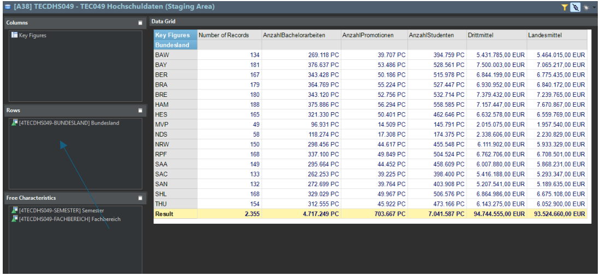
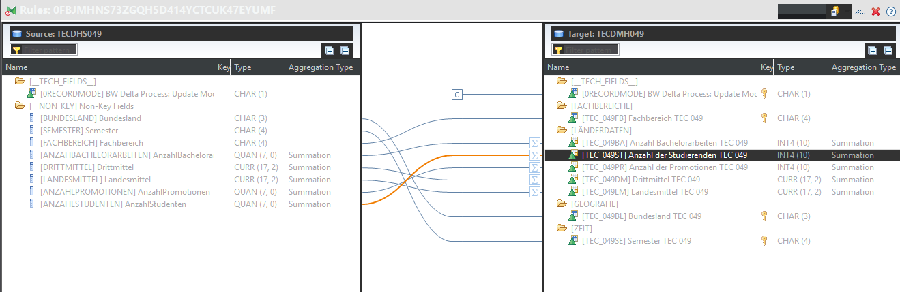
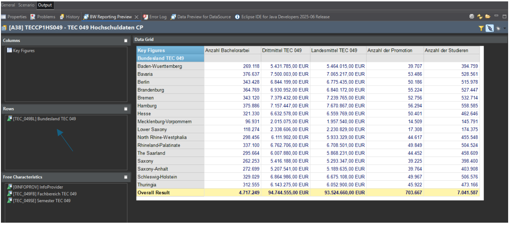
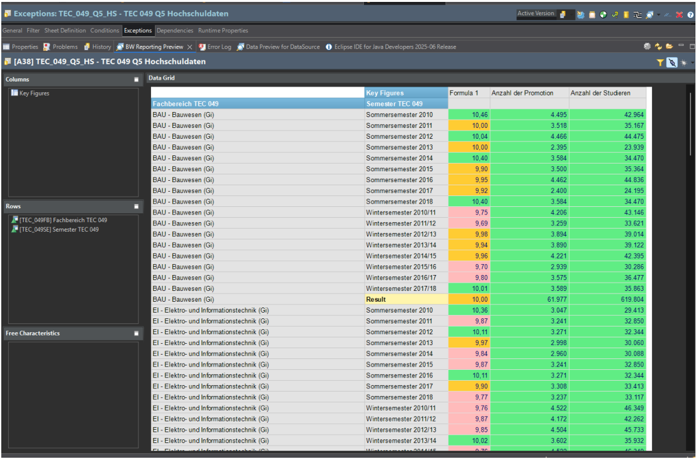
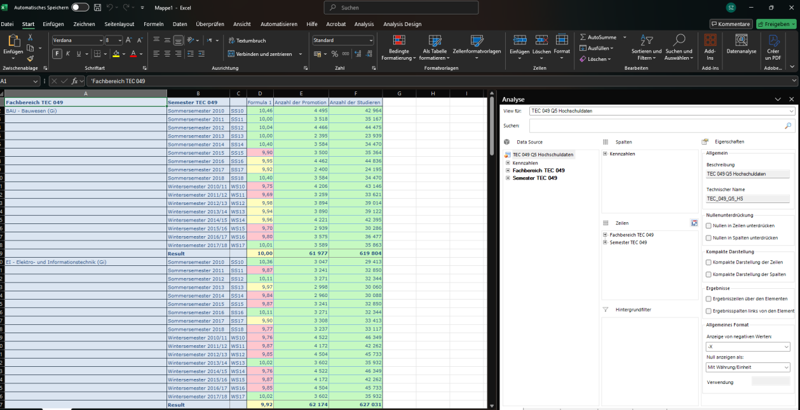

# 📊 Hochschul-Datenwarehouse – SAP BW/4HANA & Business Intelligence

> Entwickelt im Rahmen des Moduls **Business Intelligence** (Sommersemester 2025)  
> **Technische Hochschule Mittelhessen (THM)** · Studiengang **Wirtschaftsinformatik (B.Sc.)**  
> **Fallstudien A–D**: Datenintegration, Stammdaten, Data Warehouse, Data Mart und Reporting

---

## 🎯 Projektübersicht

Konzeption und praktische Umsetzung eines **mehrstufigen Business-Intelligence-Datenmodells** für die Auswertung von Hochschuldaten in einer von der Hochschule bereitgestellten **SAP-BW/4HANA-Umgebung**.

Die Fallstudien zeigen den Weg von der **Datenübernahme aus CSV-Dateien** über die Modellierung einer **Staging Area** und eines **Data Marts** bis zur Erstellung von **OLAP-Queries**. Die Ergebnisse wurden mit **SAP Analysis for Microsoft Office (Excel)** und den SAP-BW-Reporting-Funktionen analysiert.

Analysierte Größen sind unter anderem **Studierendenzahlen**, **Bachelorarbeiten**, **Promotionen**, **Landesmittel** und **Drittmittel**, gruppiert nach **Bundesland**, **Fachbereich** oder **Semester**.

> **Projektcharakter:** Dokumentiertes Studienprojekt im SAP-Trainingssystem. Dieses Repository enthält die Beschreibung und Ergebnis-Screenshots, **keine eigenständig ausführbare SAP-Anwendung** und derzeit keine SAP-Objektexporte oder Original-CSV-Dateien.

---

## 🏗️ Architektur

```text
  CSV-Dateien (Hochschul-Bewegungsdaten)
                     │
                     ▼
         DataSources / PC_FILE
                     │
                     ▼
        Transformationen + DTPs
                     │
                     ▼
       Staging aDSO (Akquisition)
                     │
                     │      Stammdaten (Bundesland,
                     │      Fachbereich, Semester)
                     │            ▲
                     │      DataSources + DTPs
                     │            │
                     ▼            │
      Data Mart aDSO ◄────────────┘
                     │
                     ▼
         CompositeProvider
                     │
                     ▼
      BW Queries Q1–Q5 / OLAP
                     │
           ┌─────────┴──────────┐
           ▼                    ▼
   BW Reporting Preview    Analysis for Excel
```

*Vereinfachte, aus der Projektdokumentation abgeleitete Übersicht – kein technischer Systemexport.*

---

## 🛠️ Technologien

| Technologie / Konzept | Einsatz im Projekt |
|---|---|
| **SAP BW/4HANA** | Data Warehouse und Modellierung von BI-Objekten |
| **Eclipse BW Modeling Tools** | Anlage von DataSources, InfoObjects, aDSOs, Datenflüssen und Queries |
| **DataSources (PC_FILE)** | Datenübernahme aus CSV-Dateien |
| **Transformationen & DTPs** | Feldzuordnung und Laden von Bewegungs- und Stammdaten |
| **InfoObjects** | Merkmale, Kennzahlen, Texte und Attribute |
| **Advanced DataStore Object (aDSO)** | Staging-Schicht und analytischer Data Mart |
| **CompositeProvider** | Virtuelle Bereitstellung der Daten für OLAP-Abfragen |
| **SAP Analysis for Microsoft Office** | Interaktive Berichte und Auswertungen in Excel |

---

## ✨ Funktionen und Projektergebnisse

- ✅ **Datenintegration:** Hochschul-Bewegungsdaten aus mehreren CSV-Datenquellen eingelesen.
- ✅ **Datentypen geprüft:** z. B. CHAR für Merkmale, CURR für EUR-Beträge sowie QUAN für Mengenzahlen.
- ✅ **Staging Area:** aDSO zur Übernahme der Transaktionsdaten mit Transformationen und DTPs modelliert.
- ✅ **Stammdaten:** Fachbereiche und Semester mit Texten bzw. Attributen in InfoObjects geladen.
- ✅ **Data Mart:** Kennzahlen und Dimensionen für die Analyse von Hochschuldaten strukturiert.
- ✅ **OLAP-Layer:** CompositeProvider und fünf Queries für unterschiedliche Analysefragen angelegt.
- ✅ **Reporting:** Ergebnisse in SAP-BW-Vorschau und in Excel dargestellt.
- ✅ **Ausnahmevisualisierung:** Prozentwerte in einem Query mit roten, gelben und grünen Bereichen hervorgehoben.

### Fünf analytische Queries

| Query | Analyseziel |
|---|---|
| **Q1** | Studierende, Bachelorarbeiten und Promotionen nach Bundesland; berechneter Anteil der Bachelorarbeiten |
| **Q2** | Top-4-Fachbereiche nach Anzahl der Bachelorarbeiten |
| **Q3** | Vergleich der Sommersemester 2014 und 2015 mit eingeschränkten Kennzahlen |
| **Q4** | Variable Filterung nach Semester und Bundesland |
| **Q5** | Anteil der Promotionen an den Studierenden mit farbiger Ausnahmedarstellung |

---

## 🗃️ Datenmodell

```text
Merkmale / Dimensionen             Kennzahlen
────────────────────────           ──────────────────────────
Bundesland                         Anzahl Studierende
Fachbereich                        Anzahl Bachelorarbeiten
Semester                           Anzahl Promotionen
  ├─ Semesterbeginn                Landesmittel [EUR]
  ├─ Semesterende                  Drittmittel [EUR]
  └─ Texte / Attribute
```

Die Kennzahlen wurden in den Fallstudien über **InfoObjects** modelliert und anschließend für Auswertungen im Data Mart bzw. CompositeProvider genutzt.

---

## 🚀 Entwicklungsschritte

1. **Fallstudie A – Datenakquisition:** DataSources und Staging-aDSO erzeugen, Daten aus CSV laden, Feldtypen kontrollieren und DTPs ausführen.
2. **Fallstudie B – Datenmodellierung:** InfoObjects für Kennzahlen und Merkmale einschließlich Stammdaten-Eigenschaften erstellen.
3. **Fallstudie C – Stammdaten:** Fachbereichs- und Semesterdaten laden, Transformationen pflegen, DTP-Ergebnisse prüfen.
4. **Fallstudie D – Data Mart:** Analytisches aDSO und einen CompositeProvider aufbauen.
5. **Fallstudie D – Reporting:** Queries Q1–Q5 erstellen, Bedingungen und Berechnungen definieren.
6. **Ergebniskontrolle:** Daten in BW Reporting Preview und Analysis for Microsoft Office (Excel) darstellen.

Weitere Details: [Fallstudie A+B](docs/fallstudie-1-datenintegration-und-modellierung.md) · [Fallstudie C+D](docs/fallstudie-2-data-mart-und-reporting.md)

---

## 📸 Screenshots

*Echte Bildschirmaufnahmen aus der Fallstudiendokumentation. Die Beispiele stammen aus einem SAP-Hochschulübungssystem.*

### 1. Datenübernahme – Staging Area



Die Vorschau zeigt die geladenen Bewegungsdaten und ihre Kennzahlen, gruppiert nach Bundesland. *(Dokumentation A+B, Seite 27)*

### 2. Transformation – Feldzuordnung



Zuordnung von Quellfeldern zu Kennzahlen und Merkmalen des Data Marts in den BW Modeling Tools. *(Dokumentation C+D, Seite 47)*

### 3. Data Mart / OLAP nach Bundesländern



Analyse verschiedener Kennzahlen je Bundesland auf Basis des modellierten Data Marts und CompositeProviders. *(Dokumentation C+D, Seite 57)*

### 4. Query Q5 – Farbige Ausnahmeauswertung



Die Kennzahl **„Anteil Promotionen“** wird anhand definierter Prozentbereiche farblich hervorgehoben. *(Dokumentation C+D, Seite 87)*

### 5. Dieselbe Analyse in Excel



Darstellung der Query-Auswertung mit **SAP Analysis for Microsoft Office (Excel)**. *(Dokumentation C+D, Seite 87)*

---

## 📁 Repository-Struktur

```text
sap-bw4hana-bi-case-studies/
├── README.md
├── README_EN.md
├── .gitignore
├── docs/
│   ├── fallstudie-1-datenintegration-und-modellierung.md
│   ├── fallstudie-2-data-mart-und-reporting.md
│   └── veroeffentlichung-checkliste.md
└── screenshots/
    ├── staging-analysis-by-state.png
    ├── transformation-field-mapping.png
    ├── olap-analysis-by-state.png
    ├── exception-report.png
    └── excel-exception-analysis.png
```

---

## 🔒 Hinweise zur Veröffentlichung

Die praktische Umsetzung erfolgte in einem **hochschuleigenen SAP-System**. Zugangsdaten, Originaldatensätze, SAP-Systemkonfigurationen und vollständige Abgabedokumente sind **nicht Teil dieses Repositories**. Screenshots können systeminterne technische Bezeichnungen enthalten. Vor einer öffentlichen Veröffentlichung bitte prüfen, ob sie weitergegeben werden dürfen.

Dieses Repository ist ein **Portfolio der dokumentierten Arbeitsschritte und Ergebnisse**; die Screenshots ersetzen keinen exportierten, wiederverwendbaren SAP-Quellcode.

---

## 👨‍💻 Über das Projekt

**Hochschulprojekt:** THM · Wirtschaftsinformatik (B.Sc.) · Business Intelligence · Sommersemester 2025

[English version](README_EN.md)
