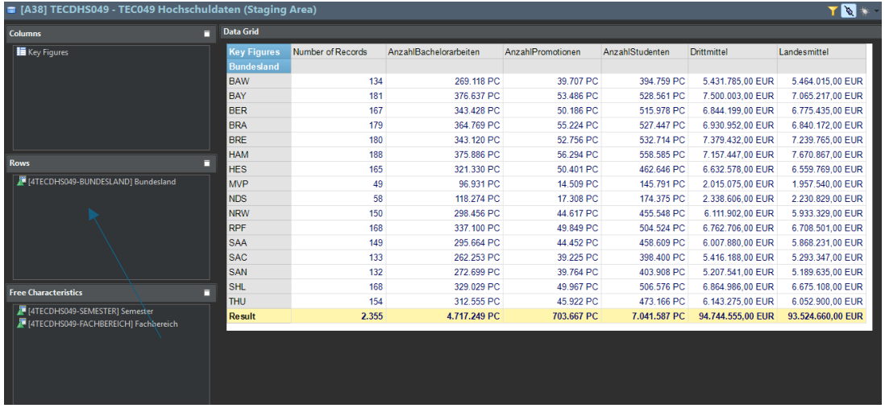
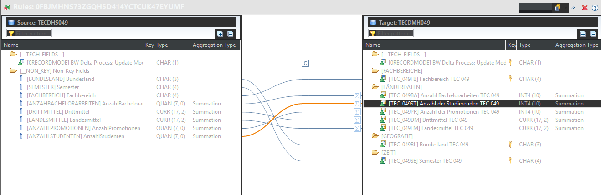
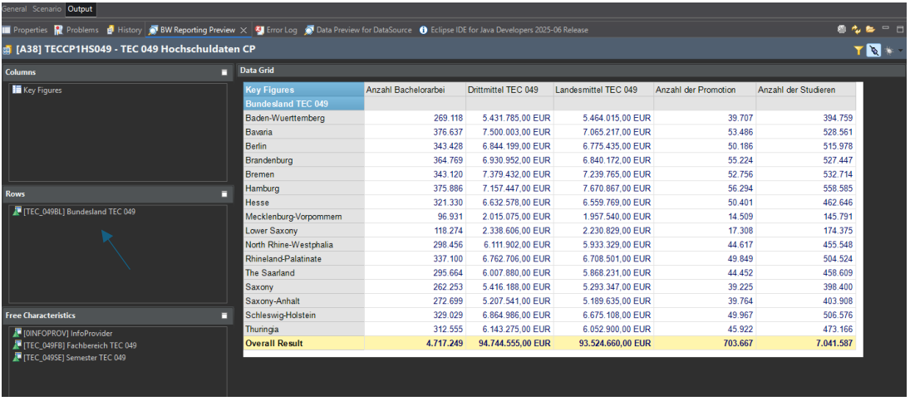
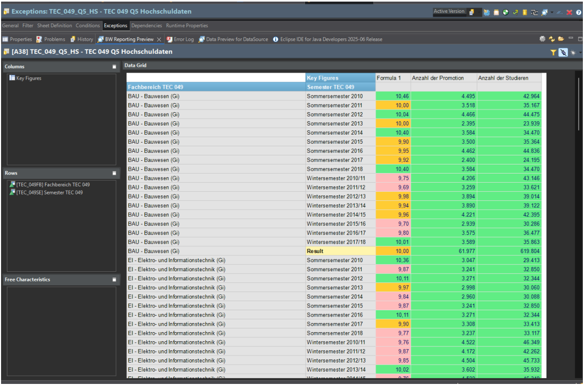
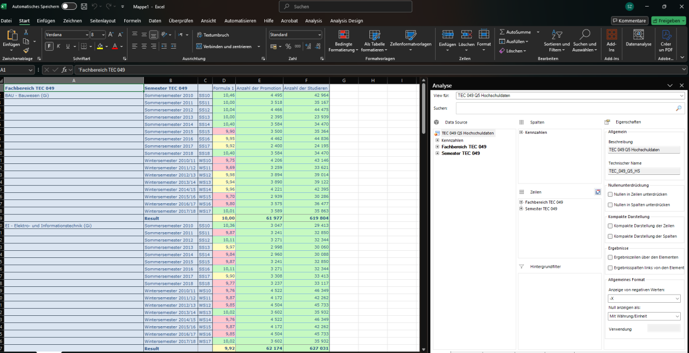

# 📊 University Data Warehouse – SAP BW/4HANA & Business Intelligence

> **Academic project · Business Intelligence · Summer semester 2025**  
> Technische Hochschule Mittelhessen (THM) · Business Informatics (B.Sc.) · Case studies A–D

## 🎯 Overview

These case studies document the implementation of a **multi-layer data warehouse and BI reporting workflow** for university-related data using a university-provided **SAP BW/4HANA** training environment. The work covered CSV ingestion, staging, master data, analytical data marts, OLAP queries and result inspection in SAP Analysis for Microsoft Office (Excel).

> **Portfolio note:** This is a documentation-and-results repository. It is not a standalone executable SAP application and does not include server access, source CSVs or SAP object exports.

## 🏗️ Architecture

```text
CSV Transaction Data
       ↓
SAP BW DataSources
       ↓
Transformations & DTPs
       ↓
Staging aDSO
       ↓       Master-data InfoObjects (state, department, semester)
Data Mart aDSO  ←────────────────────┘
       ↓
CompositeProvider
       ↓
BW Queries Q1–Q5
       ↓
BW Reporting / SAP Analysis for Microsoft Office (Excel)
```

*Conceptual architecture based on the documented workflow, not an SAP system export.*

## 🛠️ Technologies

| Technology | Purpose |
|---|---|
| SAP BW/4HANA | Warehouse modeling and reporting |
| Eclipse BW Modeling Tools | DataSources, InfoObjects, aDSOs, transformations and queries |
| Data Transfer Processes (DTPs) | Loading transactional and master data |
| CompositeProvider | Analytical / OLAP access layer |
| SAP Analysis for Microsoft Office | Excel-based report exploration |

## ✨ Project highlights

- Defined and loaded **DataSources** from CSV files, with corrected field types and properties.
- Implemented a **staging aDSO** and transformations/DTPs for transaction data.
- Created **InfoObjects** for department, semester and federal state, plus quantitative/financial measures.
- Built a **data-mart aDSO** and a **CompositeProvider** for analysis.
- Developed **five analytical queries**, including calculated ratios, top-four filtering, semester comparisons, variable filters and color-coded exceptions.
- Examined the resulting data in SAP BW reports and **SAP Analysis for Microsoft Office (Excel)**.

## 📸 Screenshots

**Staging analysis**



**Transformation / field mapping**



**OLAP analysis**



**Query Q5 exception reporting**



**Excel analysis**



## 📁 Documentation

- [Case Study A+B — Data Acquisition & Modeling (German)](docs/fallstudie-1-datenintegration-und-modellierung.md)
- [Case Study C+D — Master Data, Data Mart & Reporting (German)](docs/fallstudie-2-data-mart-und-reporting.md)

## 🔒 Publication note

Completed in an institution-managed SAP training environment. The original coursework PDFs, confidential datasets, credentials and source system configurations are intentionally excluded. Screenshots should be checked for publication permission and identifying details before the repository is made public.

[Deutsche Version](README.md)
