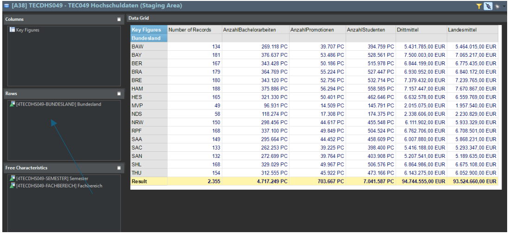

# Fallstudie 1 – Datenintegration und Datenmodellierung (Teile A+B)

**Modul:** Business Intelligence · THM · Sommersemester 2025

## Ausgangslage und Ziel

Hochschulbezogene Bewegungsdaten sollten in einer bereitgestellten SAP-BW/4HANA-Umgebung eingelesen und für spätere BI-Auswertungen modelliert werden. Die Daten wurden aus CSV-Dateien übernommen.

## Teil A – Datenakquisition

1. Zwei DataSources für die Bewegungsdaten angelegt und die Datenvorschau kontrolliert.
2. Datentypen, Feldlängen und Eigenschaften angepasst, u. a. Bundesland/Semester/Fachbereich als CHAR, Geldbeträge als CURR mit EUR und Mengen als QUAN.
3. Einen Datenfluss und ein Staging-DataStore-Objekt (aDSO) erstellt.
4. Feldzuordnungen als Transformationen definiert und Daten mit Data Transfer Processes (DTPs) geladen.
5. Die geladenen Transaktionsdaten in Datenvorschauen nach Semester, Fachbereich und Bundesland geprüft.

## Teil B – Semantische Modellierung

1. InfoObjects für Kennzahlen angelegt: Anzahl Bachelorarbeiten, Studierende, Promotionen, Landesmittel und Drittmittel.
2. InfoObjects für Merkmale angelegt: Bundesland, Fachbereich und Semester.
3. Zeit- bzw. sprachabhängige Texte und Semesterattribute modelliert.
4. Stammdaten der Bundesländer gepflegt und die angelegten Tabellen im ABAP Dictionary betrachtet.

## Ergebnis

Ein Staging-Datenmodell für Hochschuldaten und die relevanten BI-Merkmale und -Kennzahlen für die anschließenden Analysen.

*Quelle: Eigene Fallstudiendokumentation A+B, 52 Seiten. Der Originalbericht ist wegen persönlicher Angaben und Systeminformationen nicht Teil des öffentlichen Portfolios.*
