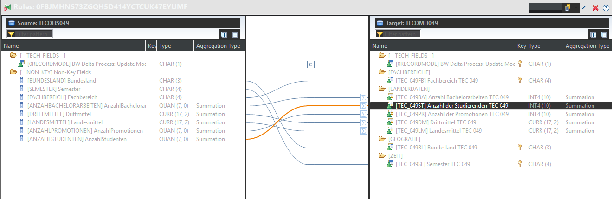
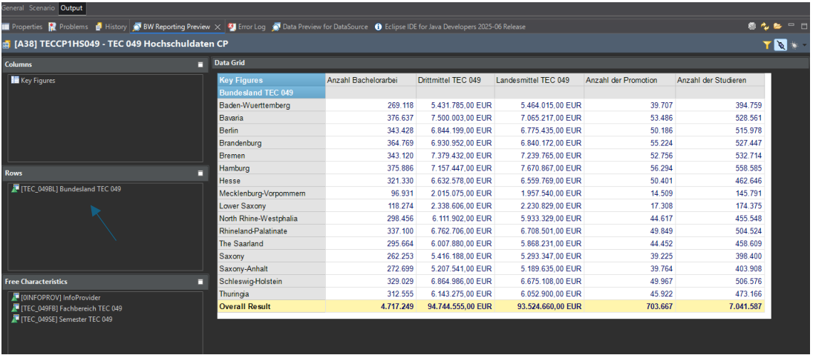
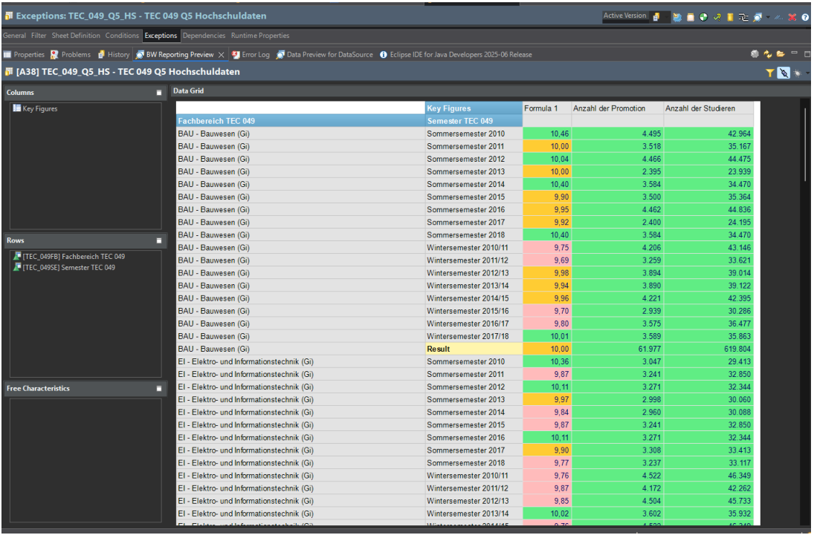
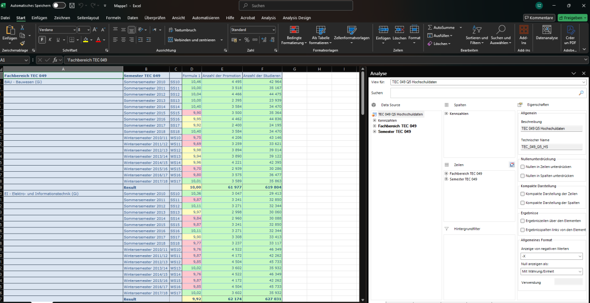

# Fallstudie 2 – Stammdaten, Data Mart und Reporting (Teile C+D)

**Modul:** Business Intelligence · THM · Sommersemester 2025

## Teil C – Stammdaten

1. Fachbereichs-Stammdaten als Text-DataSource vorbereitet und geladen.
2. Datenfluss, Feldzuordnungen, Transformation und DTPs eingerichtet.
3. Unvollständige Bezeichnungen und Schlüsselzuordnungen im Transformationsprozess berücksichtigt.
4. Semester-Stammdaten einschließlich Texten und Attributen über DataSources und InfoObjects modelliert.
5. Erfolgreiche Ladeprozesse im Monitor und über die Stammdatenpflege überprüft.

## Teil D – Data Mart und OLAP

1. Ein **Advanced DataStore Object** als Data Mart für Hochschulbewegungsdaten angelegt.
2. Kennzahlen und Merkmale zugeordnet und passende Gruppierungen bzw. Dimensionen modelliert.
3. Staging und Data Mart über Transformationen und DTPs verknüpft.
4. Einen **CompositeProvider** als Reporting-/Virtualisierungsebene angelegt.
5. **Fünf BW Queries** erstellt und die Ergebnisse in BW Reporting und Excel betrachtet.

### Abfragen Q1–Q5

| Query | Fragestellung / Methode |
|---|---|
| Q1 | Kennzahlen nach Bundesland und prozentualer Anteil Bachelorarbeiten / Studierende |
| Q2 | Top-4-Fachbereiche nach Bachelorarbeiten (TopN-Bedingung) |
| Q3 | Eingeschränkte Kennzahlen für einen Semestervergleich (Sommersemester 2014 und 2015) |
| Q4 | Dynamische Filterung für Bundesland und Semester |
| Q5 | Prozentualer Anteil Promotionen / Studierende mit farbigen Ausnahmegrenzen |

In Q5 wurde die Formel `Anzahl Promotionen / Anzahl Studierende × 100` genutzt. Für die Berichtsdarstellung wurden Ausnahmen in unterschiedlichen Farbklassen eingerichtet.

## Ergebnis-Screenshots

**Feldmapping in der Transformation:**

**OLAP-Ergebnis nach Bundesland:**

**Farbcodiertes Query-Reporting:**

**Excel-Auswertung:**

*Quelle: Eigene Fallstudiendokumentation C+D, 87 Seiten. Die Original-PDF bleibt außerhalb des GitHub-Portfolios.*
